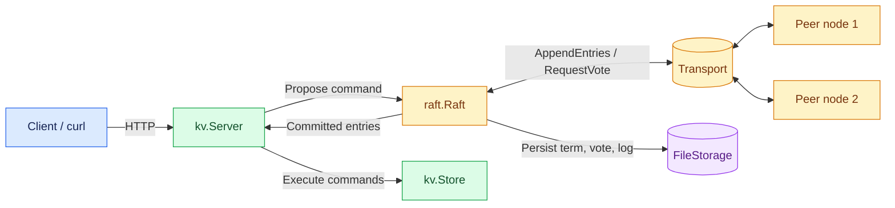
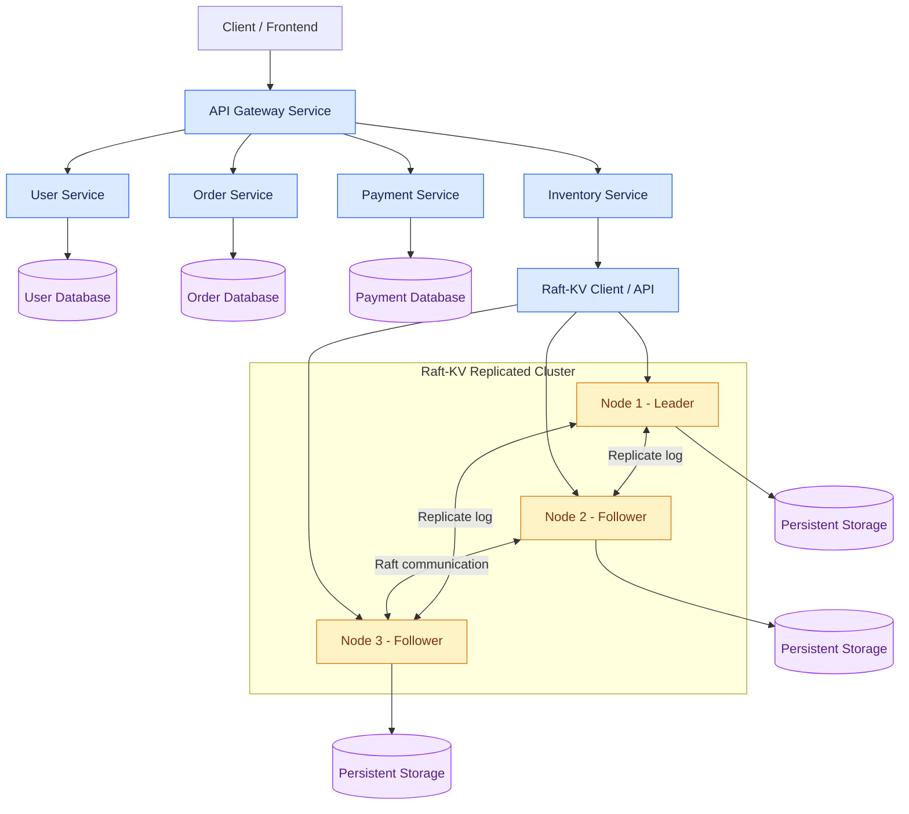

# raft-kv

A fault-tolerant, replicated key-value store written in Go. The Raft consensus algorithm is implemented from scratch, with no Raft library.

## Features

- Leader election with randomized timeouts
- Log replication, commit rules, and ordered apply (Raft paper, Figure 2)
- Persistence of `currentTerm`, `votedFor`, and `log` (gob, fsync, atomic rename)
- Replicated KV service: `Get`, `Put`, `Append`, `Delete`
- Exactly-once semantics for client retries (`ClientID` + `Seq`)
- Linearizable reads through the Raft log
- Pluggable transport: in-memory network for tests, TCP `net/rpc` for real nodes
- HTTP API on every node

## Architecture

The system consists of an HTTP server, a Raft consensus module, a transport layer, persistent storage, and a replicated key-value state machine.



### Package responsibilities

| Package | Responsibility |
|---|---|
| `raft` | Leader election, replication, commit, persistence, and transports |
| `kv` | State machine, server, clerk (client), and HTTP handler |
| `cmd/raft-kv` | Node binary |
| `cmd/bench` | Benchmark runner |
| `cmd/plot` | SVG chart generator |

## Example Deployment: Raft-KV in a Microservices System

Raft-KV can serve as a replicated key-value storage layer for a service that needs consensus-backed data replication. In a microservices architecture, other services can use their own databases.

The following diagram illustrates a possible deployment; it is not a description of additional services implemented in this repository.



**Key idea:** Raft is the consensus mechanism, not the business service itself. The three Raft nodes cooperate to agree on committed operations. A service should access the cluster through a client or API that handles leader discovery and retries.

## Run a 3-Node Cluster

Start one node in each terminal.

### Node 0

```bash
go run ./cmd/raft-kv -id 0 -peers "0=127.0.0.1:7000,1=127.0.0.1:7001,2=127.0.0.1:7002" -http 127.0.0.1:8000
```

### Node 1

```bash
go run ./cmd/raft-kv -id 1 -peers "0=127.0.0.1:7000,1=127.0.0.1:7001,2=127.0.0.1:7002" -http 127.0.0.1:8001
```

### Node 2

```bash
go run ./cmd/raft-kv -id 2 -peers "0=127.0.0.1:7000,1=127.0.0.1:7001,2=127.0.0.1:7002" -http 127.0.0.1:8002
```

## Using the HTTP API

Check a node's status:

```bash
curl http://127.0.0.1:8000/status
```

Write a value:

```bash
curl -X PUT -d "hello" http://127.0.0.1:8000/kv/greeting
```

Read a value:

```bash
curl http://127.0.0.1:8000/kv/greeting
```

Write requests should be sent to the current leader. Followers return `503 wrong leader` according to the current implementation.

State is stored in `data/node-N.bin`.

### API Endpoints

| Method | Path | Meaning |
|---|---|---|
| `GET` | `/kv/{key}` | Read a value |
| `PUT` | `/kv/{key}` | Set a value |
| `POST` | `/kv/{key}` | Append to a value |
| `DELETE` | `/kv/{key}` | Delete a value |
| `GET` | `/status` | Inspect term and leadership |

## Testing

Run the test suite with Go's race detector:

```bash
go test -race -count=3 ./...
```

### Covered Scenarios

- Leader election, stable leadership, and re-election after leader failure
- No leader without a quorum
- Log replication and lagging follower catch-up
- Committed entries survive leader failure
- Persistent term, vote, and log restoration
- No second vote in the same term after restart
- Simultaneous restart of all nodes
- Exactly-once application of duplicate client requests
- Network partitions and minority-leader behavior
- Discarding uncommitted entries after network healing
- No commit without a quorum
- Cluster convergence after network healing

All tests run with the Go race detector.

## Failure Demo (Real Processes)

1. Start three nodes.
2. Write `greeting=hello` through the current leader.
3. Stop the leader process.
4. Allow the remaining nodes to elect a new leader.
5. Verify that committed data remains available through the new leader.
6. Restart the stopped node and verify that it catches up with the cluster.

## Design Goals

- **Fault tolerance:** Continue operating when a minority of nodes fail, provided a quorum remains available.
- **Consistency:** Replicate committed operations in the same order across the cluster.
- **Durability:** Persist Raft state so nodes can recover after restart.
- **Linearizability:** Route reads through the Raft log to preserve a consistent view of operations.
- **Testability:** Use an in-memory transport for deterministic testing and TCP `net/rpc` for communication between real nodes.

## Technologies

- Go
- Raft consensus algorithm
- HTTP
- TCP `net/rpc`
- Gob serialization
- Go testing and race detector
- Mermaid diagrams

## License

Add your preferred license here.
